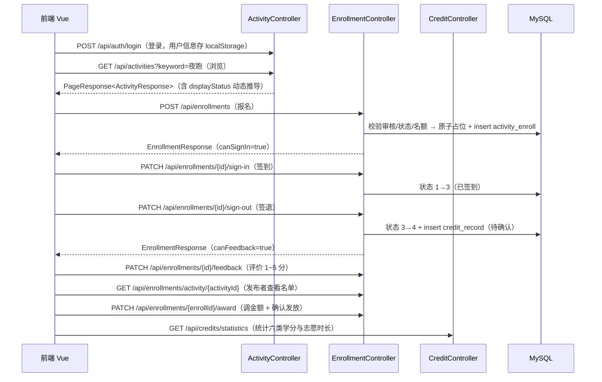

n# 智慧青途 · 后端接口文档

| 项目 | 内容 |
|---|---|
| 文档版本 | v1.1 |
| 最后更新 | 2026-11-20 |
| 适用范围 | 校园活动管理平台（智慧青途）后端 API |
| 服务地址 | `http://localhost:8082`（端口可在 `application.properties` 中修改） |
| 接口前缀 | 所有业务接口统一以 `/api` 开头 |

**修订记录**

| 版本 | 日期 | 说明 |
|---|---|---|
| v1.0 | 2026-09-14 | 初稿；同步移除 AI 推荐模块（原 `/api/recommendations/*` 接口及 `recommend_log` 表已删除） |
| v1.1 | 2026-11-20 | 后端按业务域重组；新增组合学分/灵活志愿时长、发放审核、管理员发布、AI 批量导入说明 |

---

## 1. 项目概述

智慧青途是一个面向校园场景的活动管理平台，后端基于 **Spring Boot 4 + MyBatis-Plus + MySQL**，前端为 **Vue 3 + Vite + Element Plus**。核心业务闭环：

```
注册/登录 → 浏览活动 → 发布活动（管理员发布免审核）→ 报名 → 自助签到 → 自助签退
      → 生成待确认发放记录 → 发布者/管理员按人确认学分或志愿时长 → 学分/时长统计
                              └──→ 组队：创建队伍 → 申请加入 → 队长审核 → 退出 / 解散
```

**代码分层架构**

```
HTTP 请求
   ↓
Controller（controller 包）      接收参数、@Valid 校验、只做收发
   ↓
Service 接口（service 包）       业务接口定义
   ↓
ServiceImpl（service/impl 包）   业务逻辑：权限校验、状态机、事务 @Transactional
   ↓
Repository（repository 包）      继承 MyBatis-Plus BaseMapper，负责 SQL
   ↓
Entity（entity 包）              与数据库表一一对应
   ↓
MySQL
```

**数据流转约定**：前端 → 后端传 `DTO`（dto 包，按业务域分子包）；后端 → 前端返回 `VO`（vo 包）；数据库映射用 `Entity`（entity 包）。三者分离，保证表结构不直接暴露给前端，入参出参可独立裁剪。

---

## 2. 通用规范

### 2.1 统一响应结构

所有接口返回 HTTP 200，业务结果通过 `ApiResponse<T>` 包装（`common/ApiResponse.java`）：

```json
{
  "code": 0,
  "message": "success",
  "data": { "...": {} }
}
```

| 字段 | 类型 | 说明 |
|---|---|---|
| code | Integer | 业务状态码，`0` 表示成功，非 0 表示失败 |
| message | String | 提示信息，失败时为具体错误原因 |
| data | T | 业务数据，失败时为 null |

### 2.2 分页结构

分页接口统一返回 `PageResponse<T>`（`common/PageResponse.java`），**页码从 0 开始**：

```json
{
  "code": 0,
  "message": "success",
  "data": {
    "pageNo": 0,
    "pageSize": 10,
    "totalElements": 57,
    "totalPages": 6,
    "records": [ "..." ]
  }
}
```

### 2.3 错误码总表

业务异常由 `exception/BusinessException.java` 抛出，`exception/GlobalExceptionHandler.java`
统一捕获并包装。**业务码与 HTTP 状态码同值**，取值集中在 `common/ErrorCode.java`，
不按业务模块分段：

| 码 | 含义 |
|---|---|
| 0 | 成功 |
| 400 | 参数不合法（字段/状态取值非法、时间区间非法、请求体格式错误、必填缺失） |
| 401 | 未登录、令牌无效或已过期、令牌已登出 |
| 403 | 身份有效但无权执行该操作 |
| 404 | 目标资源不存在（活动/报名/队伍/队员/学分记录/用户/静态资源） |
| 409 | 目标资源当前状态与该操作冲突（满员、重复、已结束、已取消、已解散） |
| 413 | 上传内容超出大小限制 |
| 429 | 触发频率限制（如登录失败次数过多） |
| 500 | 未预期的服务端异常 |

> ⚠️ 多个具体原因会归入同一码（例如"人数已满"与"重复报名"同为 409）。
> 区分具体原因由 `message` 承担，**客户端不应依赖提示文案做逻辑分支**。
> 完整对照与设计说明见 `docs/错误码对照表.md`。

**高频错误码速查**

| code | 含义 |
|---|---|
| 400 | 请求体 DTO 校验失败（@NotBlank/@NotNull/@Size 等） |
| 404 | 登录时用户不存在 |
| 400 | 用户名或密码错误 |
| 404 | 用户不存在（业务校验时） |
| 404 | 活动不存在 |
| 403 | 当前用户没有活动发布权限 |
| 403 | 当前用户没有活动管理权限（非发布者且非管理员/老师） |
| 404 | 报名记录不存在 |
| 409 | 活动报名人数已满 |
| 409 | 请勿重复报名 |
| 409 | 活动暂未开放签到 |
| 409 | 请先完成签到后再评价活动 |
| 404 | 队伍不存在 |
| 409 | 当前用户已在队伍中或申请待审核 |
| 403 | 仅队长可审核成员申请 |
| 403 | 仅队长可以解散队伍 |
| 404 | 学分记录不存在 |
| 403 | 仅管理员、老师或活动发布者可审核该学分记录 |

### 2.4 状态与枚举

| 枚举类 | code | 含义 |
|---|---|---|
| `ActivityTypeEnum` | 1/2/3/4 | 第二课堂学分活动 / 志愿服务活动 / 运动健身活动 / 兴趣团建活动 |
| `ActivityStatusEnum`（持久化） | 1/4 | 已发布 / 已取消（库中只存这两种） |
| 展示状态（`displayStatus`，由结束时间推导） | 1/3/4 | 已发布 / 已结束 / 已取消 |
| `EnrollmentStatusEnum` | 1/3/4 | 已报名 / 已签到 / 已完成 |
| `CreditTypeEnum` | 1~6 | 创新创业 / 智育 / 德育 / 体育 / 美育 / 劳育（志愿时长记录为空） |
| `ReviewStatusEnum` | 0/1/2 | 活动：待审核 / 已通过 / 已驳回；发放记录：待确认 / 已发放 / 不发放 |
| `TeamStatusEnum` | 0/1/2 | 招募中 / 已满员 / 已解散 |
| `TeamMemberStatusEnum` | 0/1/2/3 | 待审核 / 已加入 / 已驳回 / 已退出 |
| `UserRoleEnum` | 1/2/3/4 | 学生 / 管理员 / 老师 / 运营人员（管理端） |
| `PublisherStatusEnum` | 0/1 | 未开通发布权限 / 已开通 |

### 2.5 认证方式（当前实现）

> ⚠️ **与生产规范有差距**：当前**没有 Token / Session 后端校验**。登录成功后前端把用户信息存进 `localStorage`（`frontend_v2/src/composables/useSession.js`），后续请求以 `userId` / `operatorUserId` 等明文参数表明身份，后端仅校验该用户是否存在、角色是否满足，**不校验"你是不是你"**。详见第 7 章改造建议。

---

## 3. 数据模型（Entity ↔ 表）

所有实体继承 `entity/BaseEntity.java`，公共字段：`create_time`、`update_time`（自动填充）、`delete_flag`（`@TableLogic` 逻辑删除，0 正常 1 删除）。建表脚本见 `src/main/resources/Mysql.sql`。

| Entity | 表名 | 主键 | 说明 |
|---|---|---|---|
| `UserInfo` | user_info | student_no（学号/工号，手动输入） | 用户：角色、发布权限、专业年级、密码摘要 |
| `ActivityMain` | activity_main | activity_id（自增） | 活动主表：类型、学分、时长、时间、人数、状态、签到开关 |
| `ActivityTag` | activity_tag | tag_id（自增） | 活动标签字典表（脚本预置 6 条） |
| `ActivityTagRel` | activity_tag_rel | rel_id（自增） | 活动-标签多对多关联 |
| `ActivityEnroll` | activity_enroll | enroll_id（自增） | 报名记录：状态、签到时间、评分、评价 |
| `CreditRecord` | credit_record | record_id（自增） | 学分记录：学分、类型、审核人/状态/原因/时间 |
| `TeamMain` | team_main | team_id（自增） | 队伍主表：队长、人数、状态 |
| `TeamMember` | team_member | member_id（自增） | 队伍成员：状态、加入时间 |
| `UserInterestRel` | user_interest_rel | rel_id（自增） | 用户-兴趣标签多对多关联 |

---

## 4. 功能模块与接口清单总览

| # | 模块 | Controller | 接口数 | 完成度 |
|---|---|---|---|---|
| 1 | 认证模块 | `AuthController` | 2 | ✅ 完成（无 Token，见 2.5） |
| 2 | 活动模块 | `ActivityController` | 9 | ✅ 完成 |
| 3 | 报名模块 | `EnrollmentController` | 5 | ✅ 完成（并发保护薄弱，见 4.3） |
| 4 | 学分模块 | `CreditController` | 3 | ✅ 完成 |
| 5 | 组队模块 | `TeamController` | 7 | ✅ 完成 |
| 6 | 用户模块 | `UserController` | 5 | ✅ 完成 |

---

## 4.1 认证模块

**功能概述**：用户注册与登录。密码用 SHA-256 摘要后入库（`common/PasswordUtil.sha256()`），**未加盐**（见第 7 章）。

**接口清单**

| 方法 | 路径 | 说明 | 权限 |
|---|---|---|---|
| POST | `/api/auth/register` | 用户注册 | 公开 |
| POST | `/api/auth/login` | 用户登录 | 公开 |

**实现类清单**

| 层次 | 类 |
|---|---|
| Controller | `AuthController` |
| Service | `AuthService` / `AuthServiceImpl` |
| Repository | `UserInfoRepository` |
| Entity | `UserInfo` |
| 请求 DTO | `dto/auth/RegisterRequest`、`dto/auth/LoginRequest` |
| 响应 VO | `vo/user/UserProfileResponse`、`vo/auth/LoginResponse` |

### 4.1.1 POST /api/auth/register

**请求体（RegisterRequest）**

| 字段 | 类型 | 必填 | 约束 | 说明 |
|---|---|---|---|---|
| studentNo | String | 是 | ≤20 | 学号或工号 |
| userName | String | 是 | ≤50 | 姓名 |
| userPhone | String | 否 | ≤20 | 手机号（唯一） |
| userEmail | String | 否 | Email 格式，≤100 | 邮箱（唯一） |
| userRole | Integer | 是 | 1/2/3 | 角色：学生/管理员/老师 |
| password | String | 是 | 6~50 | 明文密码，服务端 SHA-256 后入库 |
| major | String | 否 | ≤100 | 专业 |
| grade | String | 否 | ≤20 | 年级 |

**调用顺序**：Controller 收参 → `AuthServiceImpl.register()` 校验学号/手机号/邮箱唯一性 → 构造 `UserInfo`（发布权限默认开通）→ `userInfoRepository.insert()` → 组装 `UserProfileResponse` 返回。

**响应示例**

```json
{
  "code": 0,
  "message": "注册成功",
  "data": {
    "userId": "20230001",
    "studentNo": "20230001",
    "userName": "张三",
    "userPhone": null,
    "userEmail": null,
    "userRole": 1,
    "publisherStatus": 1,
    "major": null,
    "grade": null,
    "interestTags": []
  }
}
```

### 4.1.2 POST /api/auth/login

**请求体（LoginRequest）**：`studentNo`（必填）、`password`（必填）。

**调用顺序**：Controller → `AuthServiceImpl.login()` → 按学号查 `UserInfo`（`selectOne`）→ 比对 SHA-256 摘要 → 返回 `LoginResponse`（不含密码）。前端拿到后写入 localStorage。

**响应示例**

```json
{
  "code": 0,
  "message": "登录成功",
  "data": {
    "userId": "20230001",
    "studentNo": "20230001",
    "userName": "张三",
    "userRole": 1,
    "publisherStatus": 1,
    "major": "计算机",
    "grade": "2023级"
  }
}
```

---

## 4.2 活动模块

**功能概述**：活动封面上传、CRUD、状态管理、签到开关、标签关联、分页检索。

**接口清单**

| 方法 | 路径 | 说明 | 权限校验 |
|---|---|---|---|
| POST | `/api/activities/covers` | 上传活动封面（multipart） | 无 |
| POST | `/api/activities` | 创建活动 | 发布权限 |
| PUT | `/api/activities/{activityId}` | 更新活动 | 发布者/管理员/老师 |
| PATCH | `/api/activities/{activityId}/status` | 修改状态（仅 1 已发布/4 已取消） | 同上 |
| PATCH | `/api/activities/{activityId}/sign-in-switch` | 开关签到 | 同上 |
| DELETE | `/api/activities/{activityId}` | 删除活动（级联清理） | 同上 |
| GET | `/api/activities` | 分页条件查询 | 无 |
| GET | `/api/activities/{activityId}` | 活动详情（含标签） | 无 |
| GET | `/api/activities/tags` | 标签字典列表 | 无 |

**实现类清单**

| 层次 | 类 |
|---|---|
| Controller | `ActivityController` |
| Service | `ActivityService` / `ActivityServiceImpl`（本项目最大业务类，约 490 行） |
| Repository | `ActivityMainRepository`、`ActivityTagRepository`、`ActivityTagRelRepository`、`ActivityEnrollRepository`、`CreditRecordRepository`、`TeamMainRepository`、`TeamMemberRepository`、`UserInfoRepository` |
| Entity | `ActivityMain`、`ActivityTag`、`ActivityTagRel` |
| 请求 DTO | `CreateActivityRequest`、`UpdateActivityRequest`、`ActivityQueryRequest`、`ChangeActivityStatusRequest`、`ChangeActivitySignInRequest` |
| 响应 VO | `ActivityResponse`、`ActivityTagVO`、`ActivityCoverUploadResponse` |
| 其他 | `validation/CreditUnit` + `CreditUnitValidator`（学分必须为 0.05 的倍数）、`config/UploadProperties`（上传目录/大小配置）、`config/StaticResourceConfig`（封面静态映射） |

### 4.2.1 POST /api/activities（创建活动）

**请求体（CreateActivityRequest）**

| 字段 | 类型 | 必填 | 说明 |
|---|---|---|---|
| activityTitle | String | 是，≤255 | 标题 |
| activityDesc | String | 否 | 描述 |
| activityType | Integer | 是，1~4 | 活动类型 |
| activityCredit | BigDecimal | 第二课堂活动必填 | 学分，必须 0.05 的倍数（@CreditUnit） |
| creditType | Integer | 第二课堂活动必填 | 学分类型 1~6 |
| volunteerHours | BigDecimal | 志愿活动必填 | 服务时长 |
| coverUrl | String | 否，≤500 | 封面地址（来自封面上传接口） |
| startTime / endTime | LocalDateTime | 是 | 结束必须晚于开始 |
| activityLocation | String | 否，≤255 | 地点 |
| maxParticipant | Integer | 是 | 最大人数 |
| tagIds | List\<Long\> | 否 | 标签 ID 列表 |

> 发布者不再出现在请求体：身份一律取当前登录用户（JWT）。

**调用顺序（关键校验链）**

```
ActivityController.createActivity
  → ActivityServiceImpl.createActivity
      1. requireUser：发布者存在
      2. checkClientPublishPermission：仅学生/老师，且只能发布无学分活动
      3. validateActivityTime：endTime > startTime
      4. validateTags：tagIds 均存在于 activity_tag 表
      5. validateActivityAttributes：按活动类型交叉校验学分/时长字段
      6. normalize*：按类型归一化（非第二课堂清空学分、非志愿清空时长）
      7. insert activity_main（状态=已发布，签到默认关，审核状态=待审核）
      8. syncActivityTags：全删全插 activity_tag_rel 关联
  → 返回 getActivityDetail()（含标签列表）
```

> **管理端发布**：
> - `POST /api/admin/activities`（仅管理员）支持全部活动类型，且**免审核**：立即公开可报名；
> - `POST /api/admin/credit-activities`（运营人员）支持**学分活动***或***志愿活动**，仍为待审核；
> - **客户端（学生/老师）只能发布运动健身 / 兴趣团建**，学分与志愿时长活动必须走管理端。
>
> 活动新增两种模式字段：`creditMode`（1 固定学分 / 2 组合学分）、`volunteerMode`（1 固定时长 / 2 灵活时长）。
> 组合学分需传 `creditTiers: [{ credit, quota }]`（不同学分对应不同名额，档位学分不可重复）；
> 灵活志愿时长不需要预设时长，活动结束后由发布者逐人录入并提交管理员审核。

**响应示例（ActivityResponse）**

```json
{
  "code": 0,
  "message": "活动创建成功",
  "data": {
    "activityId": 12,
    "publisherUserId": "20230001",
    "activityTitle": "校园夜跑打卡",
    "activityDesc": "每周三晚操场集合",
    "activityType": 3,
    "activityCredit": 0,
    "creditType": null,
    "volunteerHours": null,
    "coverUrl": "/uploads/activity-covers/abc123.jpg",
    "startTime": "2026-09-20 19:00:00",
    "endTime": "2026-09-20 21:00:00",
    "activityLocation": "东区操场",
    "maxParticipant": 50,
    "currentParticipant": 0,
    "activityStatus": 1,
    "displayStatus": 1,
    "signInEnabled": 0,
    "tags": [ { "tagId": 3, "tagName": "运动健身" } ]
  }
}
```

### 4.2.2 GET /api/activities（分页查询）

**Query 参数（ActivityQueryRequest，@ModelAttribute 绑定）**：`keyword`（标题模糊）、`activityType`、`activityStatus`（1/3/4，3=已结束按 `end_time < now` 动态推导）、`publisherUserId`、`pageNo`（默认 0）、`pageSize`（默认 10）。

**调用顺序**：Controller → `queryActivities()` → `LambdaQueryWrapper` 按条件组装 → `selectPage`（注意 MyBatis-Plus 页码 1 起，代码做了 `pageNo + 1` 转换）→ 每条记录 `toActivityResponse()`（顺带查标签）→ `PageResponse.from()`。

### 4.2.3 DELETE /api/activities/{activityId}（删除活动）

**Query 参数**：`operatorUserId`（操作人）。

**调用顺序（级联清理，一个事务）**：权限校验（发布者或管理员/老师）→ 依次删除 `activity_tag_rel`（标签关联）→ `activity_enroll`（报名记录）→ `credit_record`（学分记录）→ 查并删除关联 `team_member`、`team_main`（组队数据）→ 删除 `activity_main`。

### 4.2.4 其余接口要点

- **PUT 更新**：全量更新字段 + 标签重建；额外校验"最大人数 ≥ 当前已报名人数"（400）。
- **PATCH /status**：仅允许持久化状态 1/4 切换；`displayStatus` 由 `ActivityStatusEnum.resolveDisplayStatus()` 按结束时间实时推导。
- **PATCH /sign-in-switch**：0/1 合法值校验；已结束（400）、已取消（400）不能开。
- **POST /covers**：校验 Content-Type 为 image/*、扩展名白名单（jpg/jpeg/png/gif/webp）、大小 ≤5MB，随机 UUID 文件名落盘到 `uploads/activity-covers/`，返回可访问路径。
- **管理端**：管理员发布活动 `POST /api/admin/activities`（全类型、免审核）；活动审核 `PATCH /api/admin/activities/{id}/review`；参与人员与发放管理见 4.3.3。

---

## 4.3 报名模块

**功能概述**：报名、取消报名、自助签到/签退、活动评价、报名记录查询，以及活动发布者/管理员使用的参与人员与发放管理。响应 VO `EnrollmentResponse` 额外带 `canSignIn` / `canSignOut` / `canCancel` / `canFeedback` 四个前端可用性布尔值。

**接口清单**

| 方法 | 路径 | 说明 |
|---|---|---|
| POST | `/api/enrollments` | 报名 |
| DELETE | `/api/enrollments/{enrollId}` | 取消报名（仅本人） |
| PATCH | `/api/enrollments/{enrollId}/sign-in` | 自助签到（仅本人，状态 1→3） |
| PATCH | `/api/enrollments/{enrollId}/sign-out` | 自助签退（仅本人，状态 3→4 并生成发放记录） |
| PATCH | `/api/enrollments/{enrollId}/feedback` | 提交评价（签退后，1~5 分 + 内容） |
| GET | `/api/enrollments` | 分页查询自己的报名记录 |
| GET | `/api/enrollments/activity/{activityId}` | 活动参与人员名单（发布者/管理员） |
| PATCH | `/api/enrollments/{enrollId}/attendance` | 修正单人考勤（发布者/管理员） |
| PATCH | `/api/enrollments/{enrollId}/award` | 编辑并确认某人发放（发布者/管理员） |
| PATCH | `/api/enrollments/activity/{activityId}/awards/confirm` | 一键确认该活动全部待发放记录 |

**实现类清单**

| 层次 | 类 |
|---|---|
| Controller | `EnrollmentController` |
| Service | `EnrollmentService` / `EnrollmentServiceImpl` |
| Repository | `ActivityEnrollRepository`、`ActivityMainRepository`、`UserInfoRepository`、`CreditRecordRepository` |
| Entity | `ActivityEnroll`、`ActivityMain`、`CreditRecord` |
| 请求 DTO | `CreateEnrollmentRequest`、`EnrollmentQueryRequest`、`FeedbackEnrollmentRequest`、`ActivityParticipantQueryRequest`、`UpdateAttendanceRequest`、`UpdateAwardRequest` |
| 响应 VO | `EnrollmentResponse`、`ActivityParticipantVO`、`ActivityParticipantsResponse` |

### 4.3.1 POST /api/enrollments（报名）

**请求体（CreateEnrollmentRequest）**：`activityId`（必填）。报名人一律取当前登录用户（JWT），请求体里没有 `userId`。

**调用顺序**

```
EnrollmentServiceImpl.createEnrollment（事务）
  1. 取当前登录用户；校验用户存在
  2. 校验活动：已通过审核、已发布、未结束、未重复报名
  3. Redis 名额闸门（可选加速）→ activity_main 条件 UPDATE 原子占位
  4. insert activity_enroll（状态=已报名）
  5. 提交后失效活动详情缓存、热门榜 +1
```

### 4.3.2 PATCH /api/enrollments/{enrollId}/sign-in、sign-out（考勤，业务核心）

**签到调用顺序**

```
EnrollmentServiceImpl.signIn（事务）
  1. 403 仅本人；409 状态=已报名
  2. 活动校验：409 已通过审核、409 已发布、409 未结束、409 签到开关已开启
  3. 条件 UPDATE：1（已报名）→ 3（已签到），写 sign_in_time
```

**签退调用顺序**

```
EnrollmentServiceImpl.signOut（事务）
  1. 403 仅本人；409 状态=已签到；409 活动未取消
  2. 条件 UPDATE：3（已签到）→ 4（已完成），写 sign_out_time
  3. generateAwardRecord：第二课堂活动生成“学分”发放记录；
     志愿活动生成“志愿时长”发放记录；记录初始为待确认（verify_status=0）
```

**签退 → 发放确认的闭环**：签退只负责生成待确认记录；发布者（或管理员）在参与人员名单中逐人调整金额并确认发放，只有 `verify_status=1` 的记录计入统计。

### 4.3.3 参与人员与发放管理（发布者 / 管理员）

权限由服务层按数据库中的活动归属判定：**活动发布者本人或管理员**。运营人员是其发布活动的发布者，因此也可管理自己活动的名单（`SecurityConfig` 对这组接口定向放行 STAFF）。

- `GET /api/enrollments/activity/{activityId}?pageNo=&pageSize=`：返回活动摘要、汇总计数（报名/签到/签退/待确认/已发放/不发放）与分页名单（报名信息 + 考勤 + 发放记录合并）。
- `PATCH /{enrollId}/attendance`：body `{ action }`，取值 `MARK_SIGN_IN`（补签到）、`MARK_SIGN_OUT`（补签退并生成发放记录）、`REVERT_SIGN_IN`、`REVERT_SIGN_OUT`（发放已确认时禁止撤销签退）。
- `PATCH /{enrollId}/award`：body `{ credit, creditType, volunteerHours, verifyStatus, rejectReason }`。
  - 固定学分：直接调整学分/类型；组合学分：`credit` 必须等于某个档位，且该档“非不发放”记录数不能超过名额；
  - 固定志愿：直接调整时长；灵活志愿：发布者录入时长后强制进入 `verifyStatus=3 待审核`，只有管理员能通过/不发放；
  - `verifyStatus=1` 发放、`=2` 不发放（可附原因）；同一活动不同参与者可以拿到不同金额。
- `PATCH /activity/{activityId}/awards/confirm`：批量操作，按角色与模式分支：
  - 固定模式：待确认(0) → 已发放(1)；
  - 组合学分：要求所有待确认记录已选档位，再批量发放；
  - 灵活志愿：发布者 待确认(0) → 待审核(3)；管理员 待审核(3) → 已发放(1)。

### 4.3.5 AI 批量导入发放（发布者 / 管理员）

用于活动结束后批量录入志愿时长或学分。两阶段，均要求「活动发布者或管理员」：

| 方法 | 路径 | 说明 |
|---|---|---|
| POST | `/api/admin/activities/{activityId}/award-import/analyze` | multipart：`file`（xlsx/xls/csv，≤5MB，≤1000 行）、可选 `instruction`；只解析与预览，不写库 |
| POST | `/api/admin/activities/{activityId}/award-import/apply` | JSON `{ rows: [{ enrollId, value }] }`；事务内写入 |

- AI 负责识别表头行与列（学号/姓名/时长/学分），只做列识别；金额由表格提供，服务端校验。AI 不可用时按表头关键词规则识别（`aiUsed=false`）。
- 匹配：学号精确优先，姓名兜底；未报名/重名/未签退/已发放跳过均不写入，在预览中标出。同一人多行志愿时长累加；学分冲突则跳过。
- 组合学分：导入值必须匹配档位，按名额（`quota`，排除不发放记录）校验。
- 保存后统一 `verify_status=3 待审核`；运营不能自行通过，管理员在参与人员页「一键通过待审核」。
- 响应 `AwardImportPreviewVO`：`aiUsed/aiNotes/headerRow/mapping/creditTiers/summary/rows`。

### 4.3.4 其他接口要点

- **取消报名**：仅本人（403）、状态=已报名且未签到（409）、活动未结束（409）；逻辑删除报名记录并把 `currentParticipant` 回减（下限 0）。
- **评价**：仅本人（403）、必须完成签退（409）；更新 `feedbackScore` + `feedbackContent`。
- **查询**：服务端强制限定为当前登录用户自己的报名记录；`activityId` / `enrollStatus` 可自由组合过滤。

---

## 4.4 学分/发放模块

**功能概述**：发放记录查询（第二课堂学分、志愿时长）、按角色区分的可见范围、按六类学分类型与志愿时长统计。逐条学分审核已取消，发放的生成与确认统一在报名模块的「参与人员」接口中完成。

**接口清单**

| 方法 | 路径 | 说明 |
|---|---|---|
| GET | `/api/credits` | 分页查询发放记录 |
| GET | `/api/credits/statistics?userId=` | 当前用户（或管理员/老师指定的用户）学分与志愿时长统计 |

**实现类清单**

| 层次 | 类 |
|---|---|
| Controller | `CreditController` |
| Service | `CreditService` / `CreditServiceImpl` |
| Repository | `CreditRecordRepository`、`ActivityMainRepository`、`UserInfoRepository` |
| Entity | `CreditRecord` |
| 请求 DTO | `CreditQueryRequest` |
| 响应 VO | `CreditRecordResponse`、`CreditStatisticsResponse`、`UserCreditOverviewResponse` |

### 4.4.1 发放记录的生命周期

发放状态：0 待确认 / 1 已发放 / 2 不发放 / 3 待管理员审核。

```
学生完成签退
   → 插入 credit_record（verify_status=0 待确认）
      固定学分：credit=活动学分
      组合学分：credit=0（等待发布者按档位选择，名额受 creditTiers.quota 限制）
      固定志愿：volunteer_hours=活动时长
      灵活志愿：volunteer_hours 为空（等待发布者逐人录入）
   → 固定模式：发布者/管理员确认 → 1 或 2
   → 灵活志愿：发布者录入时长并提交 → 3 待审核 → 管理员通过 → 1 / 不发放 → 2
```

- 同一用户同一活动只有一条记录（唯一索引 `uk_credit_user_activity`）。
- 撤销签退时：未确认的记录会被物理删除；已发放的记录必须先改为「不发放」才能撤销签退。
- 只有 `verify_status=1` 的记录计入统计；志愿记录不参与学分分类汇总。

### 4.4.2 GET /api/credits/statistics（统计）

**调用顺序**：查该用户的**全部已发放**记录 → 学分合计（跳过志愿记录）→ 按 `creditType` 分组求和 → 汇总已发放志愿时长 → 返回 `CreditStatisticsResponse`（总学分、六类学分分项、`totalVolunteerHours`）。

> 用户模块 `GET /api/users/{userId}/credit-overview` 与本节规则一致（同样包含 `totalVolunteerHours`）。

---

## 4.5 组队模块

**功能概述**：创建队伍（队长自动成为第一名成员）、申请加入（待审核）、队长审核、退出、解散。队伍状态由人数自动推导（满员/招募中）。

**接口清单**

| 方法 | 路径 | 说明 |
|---|---|---|
| POST | `/api/teams` | 创建队伍 |
| GET | `/api/teams` | 分页查询（支持按 activityId/teamStatus/leaderUserId/memberUserId） |
| GET | `/api/teams/{teamId}` | 队伍详情（含成员列表） |
| POST | `/api/teams/{teamId}/join` | 申请加入（状态=待审核） |
| PATCH | `/api/teams/{teamId}/members/{memberId}/review` | 队长审核（加入/驳回） |
| PATCH | `/api/teams/{teamId}/members/{memberId}/exit` | 退出（本人或队长代退） |
| PATCH | `/api/teams/{teamId}/dismiss` | 解散（仅队长） |

**实现类清单**

| 层次 | 类 |
|---|---|
| Controller | `TeamController` |
| Service | `TeamService` / `TeamServiceImpl` |
| Repository | `TeamMainRepository`、`TeamMemberRepository`、`UserInfoRepository`、`ActivityMainRepository` |
| Entity | `TeamMain`、`TeamMember` |
| 请求 DTO | `CreateTeamRequest`、`TeamQueryRequest`、`JoinTeamRequest`、`ReviewTeamMemberRequest`、`ExitTeamMemberRequest`、`DismissTeamRequest` |
| 响应 VO | `TeamResponse`、`TeamMemberVO` |

### 4.5.1 典型调用顺序（组队全流程）

```
POST /api/teams（创建）
  TeamServiceImpl.createTeam：校验队长存在 → 校验关联活动存在 → maxSize≥0
  → insert team_main（currentSize=1，状态自动推导）→ insert 队长 team_member（已加入）

POST /api/teams/{teamId}/join（申请）
  applyJoin：409 未解散 → 409 未满员 → 409 无重复记录
  → insert team_member（状态=待审核）

PATCH /api/teams/{teamId}/members/{memberId}/review（审核）
  reviewMember：403 仅队长 → 409 成员不属于该队伍 → 409 成员不处于待审核
  → 400 状态仅加入/驳回 → 通过时人数+1、写 joinTime → 更新队伍状态（满员/招募中）

PATCH .../exit（退出）：本人或队长操作（403）、队长不能退出自己（409）
  → 删除成员记录 → 人数-1 → 队伍状态回退为招募中

PATCH .../dismiss（解散）：仅队长（403）
  → 队伍状态=已解散、人数清零 → 删除全部成员记录
```

### 4.5.2 响应示例（TeamResponse）

```json
{
  "code": 0,
  "message": "队伍创建成功",
  "data": {
    "teamId": 5,
    "activityId": 12,
    "activityTitle": "校园夜跑打卡",
    "leaderUserId": "20230001",
    "teamName": "夜跑搭子团",
    "teamDesc": "每周三晚一起跑",
    "maxSize": 6,
    "currentSize": 1,
    "teamStatus": 0,
    "createTime": "2026-09-14 20:00:00",
    "members": [
      { "memberId": 9, "userId": "20230001", "memberStatus": 1, "joinTime": "2026-09-14 20:00:00" }
    ]
  }
}
```

---

## 4.6 用户模块

**功能概述**：个人资料查询/修改、兴趣标签维护（先删后插）、活动历史、学分总览。

**接口清单**

| 方法 | 路径 | 说明 |
|---|---|---|
| GET | `/api/users/{userId}` | 用户资料（含兴趣标签） |
| PUT | `/api/users/{userId}` | 更新资料（姓名/手机/邮箱/专业/年级） |
| PUT | `/api/users/{userId}/interest-tags` | 更新兴趣标签（全量覆盖） |
| GET | `/api/users/{userId}/histories` | 活动历史（报名记录+活动信息） |
| GET | `/api/users/{userId}/credit-overview` | 学分总览（六类分项） |

**实现类清单**

| 层次 | 类 |
|---|---|
| Controller | `UserController` |
| Service | `UserService` / `UserServiceImpl` |
| Repository | `UserInfoRepository`、`UserInterestRelRepository`、`ActivityTagRepository`、`ActivityEnrollRepository`、`ActivityMainRepository`、`CreditRecordRepository` |
| Entity | `UserInfo`、`UserInterestRel` |
| 请求 DTO | `UpdateUserProfileRequest`、`UpdateInterestTagsRequest` |
| 响应 VO | `UserProfileResponse`、`UserActivityHistoryVO`、`UserCreditOverviewResponse` |

**要点**：更新手机号/邮箱时校验唯一性（409/409，排除自己）；更新兴趣标签前用 `LinkedHashSet` 去重、校验标签合法性（401），实现为"删除旧关联 + 插入新关联"；活动历史用 `selectBatchIds` 批量查活动避免 N+1。

---

## 5. 前端页面与接口对应关系（frontend_v2）

| 路由 | 页面 | 主要调用的接口 |
|---|---|---|
| `/` | HomeView 首页 | GET /api/activities、GET /api/activities/tags、GET /api/teams |
| `/section/:slug` | SectionView 专题页 | GET /api/activities（按类型过滤） |
| `/search` | SearchView 搜索 | GET /api/activities（keyword） |
| `/publish` | PublishView 发布 | POST /api/activities/covers → POST /api/activities |
| `/activities/:id` | ActivityDetailView 详情 | GET /api/activities/{id}、POST /api/enrollments |
| `/my-published` | 我的发布 | GET /api/activities（publisherUserId）+ PATCH 状态/签到开关、DELETE |
| `/my-joined` | 我的报名 | GET /api/enrollments + sign-in / feedback / 取消 |
| `/my-teams` | 我的队伍 | GET /api/teams（memberUserId） |
| `/teams/:id` | TeamDetailView 队伍详情 | GET /api/teams/{id}、join / review / exit / dismiss |
| `/my-published/:id/participants` | ActivityParticipantsView 参与人员与发放 | GET /api/enrollments/activity/{id}、PATCH attendance / award、PATCH awards/confirm |
| `/profile` | ProfileView 个人中心 | GET /api/users/{id}、PUT 资料/兴趣标签、GET histories、GET credit-overview |

---

## 6. 整体调用时序（典型主链路）

以"学生报名并完成发放闭环"为例：



---

## 7. 现状差距与后续完善建议（按优先级排序）

### P0 — 认证与安全（当前最大短板）

1. **引入 Token 认证**：JWT 或 Spring Session + Redis。现状是前端 localStorage 存用户信息、请求传明文 userId，任何人都可以伪造身份调用接口。改造点：`AuthController` 登录签发 Token → 拦截器/过滤器校验 → 从 Token 取当前用户，`operatorUserId` 等参数全部改为服务端从会话获取。
2. **密码加盐**：`PasswordUtil.sha256` 是裸摘要，彩虹表可破。换成 **BCrypt**（自带盐，Spring Security 的 `BCryptPasswordEncoder` 即可）。
3. **接口鉴权**：目前靠 Service 层手写 `checkPublishPermission` / `canReviewCredit` 等零散判断。引入 Spring Security 用 `@PreAuthorize` + 角色模型统一管理。
4. 全局异常兜底不要直接把 `exception.getMessage()` 透传给前端（`GlobalExceptionHandler.handleException`），生产会泄漏内部信息，应记日志、返回通用提示。

### P1 — 数据一致性

5. **报名并发**：`(user_id, activity_id)` 加唯一索引 + 捕获重复键异常；`current_participant` 的"读-改-写"改为原子 SQL（`UPDATE ... SET current_participant = current_participant + 1 WHERE ... AND current_participant < max_participant`）或乐观锁（version 字段）。
6. **组队人数**同理：审核通过时的人数 +1 也建议原子化。
7. 兴趣标签"先删后插"、活动标签"先删后插"建议加事务保障（当前已有 @Transactional，可保持；重点是确认隔离级别与回滚边界）。

### P1 — Redis 落地（依赖已引入但未使用）

8. 活动详情缓存（`activity:detail:{id}`，TTL + 更新时失效）、热门活动/标签统计（`ZSet`）、学分统计缓存、签到开关缓存。
9. 分布式锁（Redisson）解决签到/报名并发。

### P1 — 接口工程化

10. **Swagger/OpenAPI**：引入 `springdoc-openapi`，Controller 注解自动生成在线接口文档，与本文档互补。
11. **分页规范**：统一 0-based 页码（已做）前提下，考虑升级为标准 PageResult 含 `hasNext`；`CreditQueryRequest.activityId` 等字段补注释。
12. 收敛重复接口：`GET /api/credits/statistics` 与 `GET /api/users/{id}/credit-overview` 逻辑重复，保留一个并内部复用。
13. 生产环境关闭 `mybatis-plus.configuration.log-impl=StdOutImpl` 全量 SQL 打印（当前性能杀手），改用日志级别控制。

### P2 — 业务完整性

14. **发布审核流**：当前创建活动即"已发布"。建议增加草稿→提交→管理员审核的 `ActivityStatusEnum` 状态机（枚举里已预留 2 进行中的位码但未使用）。
15. **发布权限管理接口缺失**：`publisher_status` 字段存在，但没有管理员接口去开通/关闭用户发布权限，`UserRoleEnum.ADMIN` 的管理功能只做了一半。
16. **活动评价展示**：评价已能写入，但活动详情接口未返回评价列表，建议增加聚合展示。
17. **队伍模块**：`TeamMemberStatusEnum.EXITED(3)` 定义未使用（退出目前是物理删除）；建议增加"队长转让"；解散后成员记录删除导致历史不可查，可改为软删除。
18. **通知**：报名成功/审核结果/队伍审核结果等目前无任何消息通知，可加站内信或接入邮件。
19. **定时任务**：活动结束状态目前靠查询时动态推导，可加定时任务落库/推送提醒。

### P2 — 前端工程化

20. **收敛前端**：目前存在 `src/main/resources/static/`（旧版静态页）、`frontend/`（v1）、`frontend_v2/`（v2）三个前端，建议只保留 `frontend_v2`，删除其余两个，避免维护漂移。
21. 引入 **TypeScript + Pinia**：`useSession` 目前是手写 localStorage 响应式封装，换成 Pinia 持久化插件更规范。
22. 前端增加**路由守卫**（未登录跳登录）、401 统一处理、axios 拦截器重试。

### P3 — 测试与部署

23. **测试覆盖率**：目前仅 `PasswordUtilTests`、`CreditUnitValidatorTest` 两个测试类。建议为各 ServiceImpl 补单元测试（Mockito）+ 报名/签到/审核链路的集成测试（Testcontainers 或 H2）。
24. **CI/CD**：GitHub Actions 跑 `mvn test` + `npm run build`；Dockerfile + docker-compose（MySQL + Redis + 应用）一键部署。
25. **对象存储**：封面图目前落本地 `uploads/`，换 MinIO/OSS + CDN，并做图片压缩（缩略图）。
26. 监控：actuator 已引入，可接 Prometheus + Grafana 做基础监控大盘。

---

## 附录 A：后端包结构速查

> 分层与依赖规则详见《后端架构与开发规范》（`docs/后端架构与开发规范.md`）。

```text
com.example.zhihuiqingtu
├── ZhihuiqingtuApplication        # 启动类（@MapperScan 登记各域 repository）
├── common/                        # ApiResponse、PageResponse、ErrorCode、TransactionEvents、BaseEntity
├── config/                        # Security / MyBatis-Plus / Redis / OpenAPI / 上传与静态资源
├── security/                      # CurrentUser、JWT 解析/校验、黑名单与吊销（jwt/、support/）
├── exception/                     # BusinessException + GlobalExceptionHandler
├── validation/                    # @CreditUnit 自定义校验
├── auth/                          # 注册/登录/登出
├── user/                          # 用户资料、兴趣标签、学分总览、用户状态枚举
├── activity/                      # 活动域：发布/审核/查询/标签/档位/缓存/库存/热门榜
├── enrollment/                    # 报名域：报名、取消、签到/签退、评价
├── award/                         # 发放域：参与人员、考勤修正、发放与批量审核、统计、导入记录工厂
├── team/                          # 组队域
├── publisher/                     # 发布资格申请域
├── admin/                         # 管理端交付通道（/api/admin/**）
│   ├── support/                   # AdminGuard、AdminPages
│   └── auth/ activity/ award/ dashboard/ enrollment/ publisher/ team/ user/
└── ai/                            # AI 平台能力：对话、推荐、工具、待确认动作、表格列识别
```

## 附录 B：环境变量（.env.example）

| 变量 | 默认值 | 说明 |
|---|---|---|
| DB_URL / DB_USERNAME / DB_PASSWORD | 本地 MySQL | 数据库连接 |
| REDIS_HOST / REDIS_PORT | localhost / 6379 | Redis（预留） |
| UPLOAD_BASE_DIR | ./uploads | 封面上传目录 |
